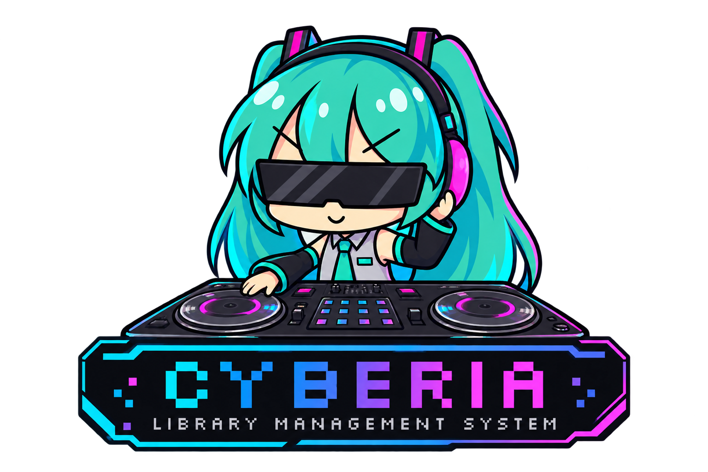

<p align="center">
  
</p>

# Cyberia Library Management System

App de escritorio (**Windows y macOS**) para bajar canciones sueltas, playlists completas o una **cola de varias playlists**, organizar y analizar tu biblioteca (BPM, tonalidad, rejilla, cues) y **exportarla a una memoria USB para CDJ/XDJ Pioneer**. Por dentro usa [yt-dlp](https://github.com/yt-dlp/yt-dlp) y [ffmpeg](https://ffmpeg.org); la app es [Wails](https://wails.io) (backend en Go + interfaz en Vue 3).

> Úsala solo para contenido que tengas derecho a descargar (tus propias subidas, tracks marcados como descargables, licencias libres, etc.). Cada quien es responsable de lo que baja.

## Instalación rápida

Elige tu sistema. No hace falta saber programar: son unos cuantos comandos.

### macOS

1. Abre la **Terminal** y, si no tienes Homebrew, instálalo desde <https://brew.sh>.
2. Instala Git: `brew install git` (o con las Xcode Command Line Tools: `xcode-select --install`).
3. Descarga el proyecto y prepáralo (instala Go, Node, ffmpeg, la CLI de Wails y las dependencias):

```bash
git clone <este-repo> cyberia && cd cyberia
./scripts/setup.sh
```

4. Compila la app y ábrela:

```bash
./scripts/build.sh
open build/bin/Cyberia.app
```

La app no tiene firma de Apple Developer (cuesta 99 USD/año), así que macOS la bloquea la primera vez («podría contener software malicioso» / «está dañada»). No es un error de la app. Soluciones (basta una):

- Terminal: `xattr -dr com.apple.quarantine /Applications/Cyberia.app` y vuelve a abrirla. Hazlo **solo con zips de la página oficial de Releases** y comprueba antes la suma con `shasum -a 256 Cyberia-macos.zip` contra la del archivo `SHA256SUMS` del mismo Release.
- O: intenta abrirla, luego **Ajustes del Sistema → Privacidad y seguridad** → baja hasta «Cyberia» → **Abrir de todos modos**.

**Para compartir un .zip a usuarios de Mac:** `./scripts/build.sh --universal --zip` deja `dist/Cyberia-macos.zip` (firmado ad-hoc, corre en Intel y Apple Silicon). También lo genera GitHub Actions. Quien lo reciba debe hacer el paso del `xattr` de arriba una vez (el Release incluye `SHA256SUMS` para verificar la descarga).

### Windows

1. Instala [Git for Windows](https://git-scm.com/download/win) (incluye **Git Bash**). Usa siempre **Git Bash** para los comandos de abajo.
2. Abre **Git Bash** y descarga el proyecto:

```bash
git clone <este-repo> cyberia && cd cyberia
./scripts/setup.sh
```

   El script instala Go, Node, ffmpeg y Python con `winget` si faltan. Si instaló algo nuevo, **cierra y vuelve a abrir Git Bash** y ejecuta `./scripts/setup.sh` otra vez para que termine.

3. Compila y abre la app:

```bash
./scripts/build.sh
./build/bin/Cyberia.exe
```

SmartScreen puede mostrar «Windows protegió su PC»: **Más información** → **Ejecutar de todos modos**. Hace falta el runtime WebView2 (ya viene en Windows 10/11 actualizados).

### ¿Ya hay una versión compilada?

Si alguien te pasa el `.zip` (pestaña **Releases**), solo descomprímelo: en macOS mueve `Cyberia.app` a Aplicaciones; en Windows ejecuta `Cyberia.exe`. Necesitas ffmpeg instalado (`brew install ffmpeg` / `winget install Gyan.FFmpeg`); yt-dlp lo baja la app sola.

### Instalar las dependencias a mano

`requirements.txt` lista lo que se instala con pip (yt-dlp y un ffmpeg portátil de respaldo):

```bash
python3 -m pip install -r requirements.txt     # en Windows: py -m pip install -r requirements.txt
```

Además necesitas [Go 1.23+](https://go.dev/dl/), [Node 20+](https://nodejs.org) y la CLI de Wails (`go install github.com/wailsapp/wails/v2/cmd/wails@v2.10.2`; `wails doctor` revisa que no falte nada). `./scripts/setup.sh` hace todo esto por ti.

## Qué hace

Seis pestañas:

- **FETCH** — pegas una o varias URLs (una por línea): SoundCloud, YouTube, Spotify o cualquier sitio que entienda yt-dlp. **Analizar** muestra qué hay detrás sin bajar nada (en playlists puedes desmarcar canciones); **Añadir a la cola** las baja con N descargas en paralelo. Si YouTube pide verificar que no eres un bot, elige tu navegador en CONFIG → YouTube para que yt-dlp use sus cookies. Convierte a MP3, M4A, Opus, FLAC o WAV con metadatos y carátula. Si cierras la app a medias, la cola continúa al volver a abrirla.
- **QUEUE** — la cola de descargas: progreso, reintentar fallidas, mostrar el archivo.
- **PLAYER** — reproductor de tu biblioteca: eliges una carpeta y **cada subcarpeta es una playlist** (los archivos sueltos van a «(sueltas)»). Buscador de carpetas, botón **+ Nueva** para crear playlists y mover canciones entre carpetas (arrastrándolas a otra carpeta o con el selector MOVER; marcando **COPIAR** en ese diálogo la canción queda en las dos playlists, con sus cues y rejilla). Una mascota (Hatsune Miku, GIR o Breakdance Cat; se elige en CONFIG) baila al tempo del tema mientras suena (dos coreografías que se alternan) y se queda en idle en pausa. El reproductor analiza cada canción (MP3, M4A, OGG… y también **WAV, FLAC y AIFF**, que se decodifican con ffmpeg; hasta 30 min por archivo): BPM (con rejilla de pulsos; se proponen varios tempos y gana el que mejor encaja con el bombo y el bajo en toda la canción, y si queda duda aparecen botones «¿OTRO?» con los tempos alternativos), tonalidad (Camelot o nota, se elige en CONFIG, con indicador de confianza) y forma de onda de 3 bandas estilo Rekordbox con colores neón: vista general clicable y vista ampliada que se desplaza con números de compás. **Barra espaciadora** = play/pausa. «ANALIZAR TODAS» analiza una por una las canciones de la playlist que falten (amarillo = sin analizar, verde = analizada, blanco = sonando). Cada canción tiene botones MOVER (con buscador) y BORRAR (a la papelera del sistema, con confirmación). Ecualizador de 10 bandas, shuffle/loop, y un visualizador audiorrítmico generativo: BARS, SCOPE, MANDALA, SPIRO y TUNNEL (o AUTO, que los va rotando).
- **PLAYER (rejilla y cues)** — debajo de la forma de onda puedes **ajustar la rejilla** (BPM exacto, ÷2/×2, mover ±1/±10 ms; «PULSO 1 AQUÍ» fija el punto bajo el cursor como un **pulso 1 de compás** —el de cada sección o frase— y reacomoda toda la rejilla respecto a él; «AJUSTAR AL GOLPE» lo pega al ataque más cercano; FASE ◂1 / 1▸ mueve cuál pulso es el 1; restaurar) y poner **hot cues A–H** (teclas 1–8; **Shift+clic** sobre el botón del cue, o clic derecho, lo borra) y **memory cues**, con imán opcional al pulso. Todo se guarda por canción y viaja con ella si la mueves de playlist.
- **PLAYER (convertir)** — el botón **CONVERTIR…** de la playlist pasa todas sus canciones a otro formato (MP3, M4A, Opus, FLAC o WAV; calidad en kbps para los formatos con pérdida) conservando etiquetas, carátula, rejilla, cues y análisis (en MP3 y Opus además de kbps hay calidad VBR, y también se ofrece AAC crudo `.aac`, que no lleva etiquetas ni carátula). Tú eliges qué hacer con los originales: **conservarlos** (el convertido queda al lado), **crear una playlist nueva** solo con los convertidos (con el nombre que quieras) o **reemplazarlos** (el original va a la papelera del sistema, recuperable). En la opción de playlist nueva, las canciones que ya estaban en el formato elegido se copian tal cual, así la playlist queda completa. Nunca sobrescribe: si el destino ya existe, esa canción se omite. Se puede detener a la mitad. **Ojo con los formatos con pérdida:** los codificadores añaden un pequeño retraso al inicio; los reproductores que leen los metadatos gapless (la mayoría) lo compensan y el desfase es 0 ms, pero sin ellos queda ~25 ms en MP3 y ~23 ms en M4A, por lo que la rejilla de un archivo convertido podría necesitar un ajuste fino.
- **PLAYER (normalizar)** — el botón **NORMALIZAR** de la canción abre un diálogo para elegir otra de **referencia**: mide ambas (LUFS integrados, requiere ffmpeg), calcula la ganancia y **sobrescribe el archivo** para igualar el volumen (con limitador de picos). Antes guarda una copia del original en la carpeta de datos de la app (`normalize-backups`, las últimas 20). Conserva etiquetas, carátula, rejilla y cues; en MP3/M4A la recodificación pierde una mínima calidad y puede mover el tiempo unos milisegundos. No admite OGG.
- **MAP** — mapa de tu biblioteca por BPM (horizontal) y tonalidad (filas de la rueda Camelot): las canciones cercanas mezclan bien. Pulsa **Analizar** para calcular las que falten, filtra por playlist/BPM/tonalidad, elige una canción y verás recomendaciones (misma tonalidad, adyacentes, relativa mayor/menor, ±2 en la rueda, con BPM compatible). Desde ahí puedes reproducir, mover y borrar como en el reproductor, y armar un **set** (+SET) que se reproduce completo o se guarda con **Crear playlist…**: crea una carpeta nueva (con el nombre que elijas) con copias numeradas en el orden del set; los originales no se tocan. El reproductor no cambia.
- **EXPORT** — manda música a una **memoria USB para CDJ/XDJ Pioneer**. Arriba aparecen las memorias detectadas como tiles (con el espacio libre); al elegir una se ven las playlists que ya tiene. Dos vistas que se suman: **PLAYLISTS** (playlists completas, con filtro) y **CANCIONES** (canciones sueltas hacia una playlist nueva o hacia una que ya existe en la memoria). Las filas marcadas se ven en fucsia y a la derecha hay un **resumen** (playlists, canciones que se añaden a cada una, total a copiar y tamaño) con el botón de exportar debajo. Escribe audio en `/Contents`, base `export.pdb` (DeviceSQL), análisis `ANLZ` (rejilla, formas de onda y hot/memory cues) y `exportExt.pdb`. **Es incremental**: nunca se crea la memoria desde cero; se conserva todo lo que ya tiene (se guarda `export.pdb.bak`) y solo se agrega lo nuevo; los archivos que ya están no se copian otra vez. Formato de reproducción: MP3, M4A, FLAC o WAV, memoria en FAT32/exFAT. No genera `exportLibrary.db` (OneLibrary): equipos que solo lean esa base no verán lo añadido. Elige el **color de la onda** del reproductor (azul, RGB o 3 bandas; se guarda en `DEVSETTING.DAT`, que ya existía se modifica solo en ese ajuste y en el formato de tonalidad) y la tonalidad se escribe en la notación de CONFIG (Camelot «8A» o notas «Am»; en Camelot el texto de la tonalidad ya es el código, igual que en el análisis). Las canciones sin analizar se copian sin onda ni rejilla (usa «Analizar todas» en PLAYER). Basado en ingeniería inversa de [rbxport](https://github.com/chrisle/rbxport); ya probado con rekordbox.
- **CONFIG** — carpeta de la biblioteca, formato y calidad, credenciales de Spotify, yt-dlp y ffmpeg.

La carpeta de destino de las descargas es la misma que la biblioteca del reproductor: una playlist termina en `<biblioteca>/<nombre de la playlist>/01 - Título.mp3` y aparece sola en PLAYER.

### Spotify

Spotify no permite bajar su audio. La app lee solo los **metadatos** (título, artista, duración) con tu propia app de Spotify, busca cada tema en YouTube y descarga el resultado únicamente si coincide con claridad (título, artista y duración ±15 s; descarta versiones en vivo/remix si no las pediste). Si no hay una coincidencia clara, esa canción falla con un mensaje en vez de bajar algo equivocado.

1. Crea una app gratis en <https://developer.spotify.com/dashboard>. Como Redirect URI pega exactamente `http://127.0.0.1:8888/callback` (CONFIG también la muestra).
2. Copia Client ID y Client Secret en **CONFIG → Spotify**. Con eso funcionan canciones y álbumes.
3. Para **tus playlists y «Me gusta»** pulsa **Login** (se abre el navegador una vez).

Limitaciones de Spotify desde 2026: el dueño de la app debe tener Premium, y las playlists que no son tuyas ni colaborativas pueden no ser legibles. Cada amigo usa sus propias credenciales; se guardan solo en su computadora (permisos 0600) y el token de sesión nunca llega a la interfaz.

**Ventana:** se puede maximizar (Windows) o pasar a pantalla completa (macOS) con el botón ⛶ de la barra superior, F11 o Ctrl+⌘+F; las letras se agrandan con la ventana y se ajustan con Ctrl/⌘ + y −.

## Desarrollo

```bash
./scripts/dev.sh        # modo desarrollo con recarga en vivo (wails dev)
./scripts/build.sh      # compila: build/bin/Cyberia.app (macOS) o build/bin/Cyberia.exe (Windows)
go test -race ./src/backend/*/...      # pruebas de los subpaquetes del backend (sin Wails)
(cd src/frontend && npm test)         # pruebas del frontend (detector de BPM, FFT)
```

- Para un `.app` que corra en Intel y Apple Silicon: `./scripts/build.sh --universal` (añade `--zip` para dejar el zip listo en `dist/`).
- No se puede compilar el binario de Mac desde Windows (ni al revés). Por eso hay un workflow de GitHub Actions (`.github/workflows/build.yml`) que compila los dos; al subir un tag (`git tag v0.1.0 && git push --tags`) corre los tests y adjunta los `.zip` a un Release.
- La interfaz trae un simulador del backend para trabajar el diseño en el navegador: `cd src/frontend && npm ci && npm run dev`.
- Los tests de `src/backend/ytdlp`, `normalize`, `convert` y `decode` usan yt-dlp y ffmpeg reales (sin tocar internet); si no los tienes instalados, se omiten.

### «Cyberia está dañada o incompleta» (macOS)

Casi siempre es un `build/darwin/Info.plist` viejo (de cuando el proyecto se llamaba `musicdl`) que apunta a un ejecutable que ya no existe; `./scripts/build.sh` lo borra antes de compilar. Si aun así bloquea: `xattr -dr com.apple.quarantine build/bin/Cyberia.app && codesign --force --deep --sign - build/bin/Cyberia.app`.

## Estructura del repositorio

```
.
├── main.go                  Entrada de Wails (debe estar en la raíz): solo arranca src/backend
├── wails.json               Configuración de Wails (apunta a src/frontend)
├── go.mod
├── requirements.txt         Dependencias que se instalan con pip (yt-dlp, ffmpeg portátil)
├── scripts/                 setup.sh (instala todo) · dev.sh · build.sh
├── docs/                    Imágenes del README
├── build/                   Icono y archivos de empaquetado de Wails
├── .github/workflows/       CI: tests y builds de Windows/macOS
└── src/
    ├── backend/             Go
    │   ├── app.go, export_usb.go, normalize_app.go, run.go   Métodos que ve Vue y arranque de la ventana
    │   ├── ytdlp/           Wrapper de yt-dlp: instalar/actualizar, vista previa, búsqueda, descarga
    │   ├── spotify/         API de Spotify (metadatos) y login PKCE
    │   ├── match/           Puntúa resultados de YouTube contra una canción de Spotify
    │   ├── library/         Escaneo de la biblioteca y servidor local de audio (127.0.0.1, con token)
    │   ├── queue/           Cola con workers, cancelar/reintentar y persistencia
    │   ├── settings/        Ajustes en JSON
    │   ├── trackmeta/       Análisis, rejilla y cues por canción (JSON + formas de onda)
    │   ├── normalize/       Normalización de volumen con ffmpeg
    │   ├── pioneer/         Escritor de USB Pioneer (export.pdb, ANLZ, DEVSETTING); port de rbxport (GPL)
    │   └── trash/           Enviar a la papelera del sistema
    └── frontend/            Vue 3 + TypeScript (src/player: motor Web Audio, EQ y visualizadores)
```

Los datos de la app (ajustes, cola, copia de yt-dlp, copias de seguridad de «normalizar») están en:
`%AppData%\Cyberia` (Windows) · `~/Library/Application Support/Cyberia` (macOS).

## Licencia

GPL-2.0-or-later (ver `LICENSE` y `NOTICE.md`): el exportador USB es un port de código GPL de rbxport, así que el proyecto entero lo es. Si lo compartes, comparte también el código fuente.

## Si algo falla

- **Una canción sale con error:** pasa el mouse/lee el mensaje en la cola. Suele ser un track privado, borrado o sin descarga permitida. Puedes **Reintentar**.
- **Todo falla de golpe:** CONFIG → **Actualizar** (yt-dlp). Casi siempre es eso.
- **"ffmpeg no encontrado":** instálalo (`brew install ffmpeg` / `winget install Gyan.FFmpeg`, o ejecuta `./scripts/setup.sh`) y reabre la app. En macOS las apps no ven el PATH de la terminal, pero Cyberia busca también en `/opt/homebrew/bin` y `/usr/local/bin`.
